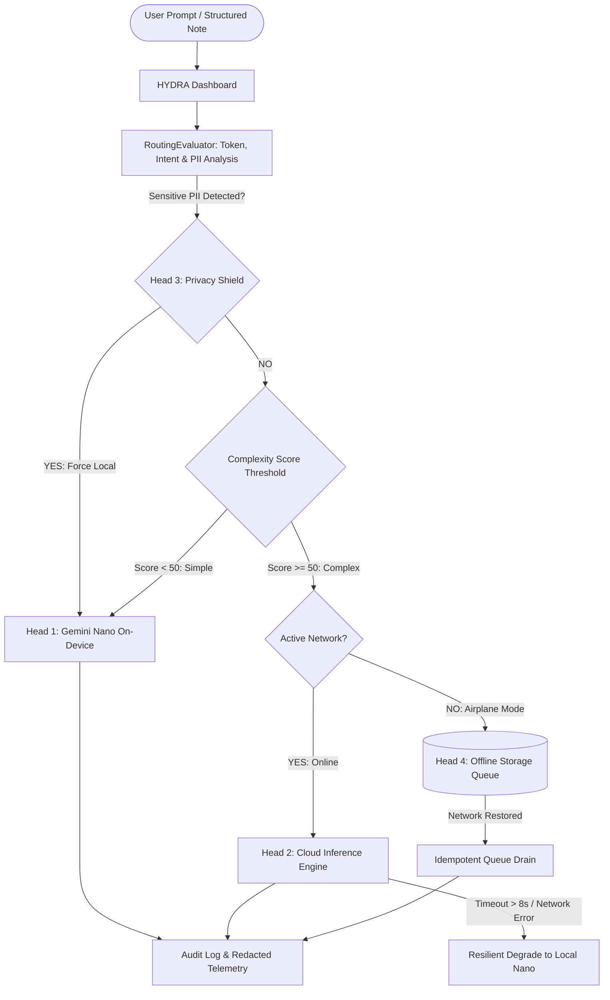

# HYDRA (Agent AI) — Hybrid AI Orchestration Engine

> **HYDRA Agent AI: Intelligent Hybrid Local & Cloud Inference Orchestrator**  
> **Author:** Jamar Masias | **Production App:** [hydra-agent.vercel.app](https://hydra-agent.vercel.app/) | **Repository:** [github.com/jammar24/Hydra-Agent](https://github.com/jammar24/Hydra-Agent)  
> **License:** Apache-2.0 (Open Source)  
> **Tagline:** *"Many heads. One decision: where to think." / "Varias cabezas, una decisión: dónde pensar."*

---

## 1. Overview & Problem Statement

Modern AI agents often rely exclusively on remote cloud APIs:
- **Unnecessary Token Costs:** Everyday queries and repetitive parsing incur full cloud billing.
- **Network Latency:** Each simple request experiences 1-3 seconds of latency over the wire.
- **Complete Offline Failure:** When connectivity is lost, the agent stops working entirely.
- **Privacy Risks:** Sensitive data (passwords, tokens, credentials) travels to remote servers.

### The HYDRA Solution
Inspired by the multi-headed architecture, **HYDRA** delegates computational workloads across **4 specialized heads**:

1. **Head 1 — Local On-Device Inference (Gemini Nano):**  
   Leverages device hardware via Chrome's native Prompt API for rapid summarization and structured JSON extraction with zero network token consumption.
2. **Head 2 — Scalable Cloud Inference (Gemini Cloud via Firebase AI Logic):**  
   Escalates complex, high-context reasoning tasks to the cloud with real-time token streaming verified by Firebase App Check attestation.
3. **Head 3 — Zero-Trust Privacy Shield:**  
   Scans prompts in memory for confidential patterns (emails, passwords, API keys, credit cards, government IDs/SSNs). Automatically isolates sensitive tasks locally to prevent remote data leaks.
4. **Head 4 — Offline Synchronization & Resilience:**  
   Offline tasks execute immediately on-device; complex cloud queries queue safely in IndexedDB via Firestore for idempotent reconciliation upon reconnection.

---

## 2. Architectural Decision Flow



---

## 3. Automated Test Suite (23/23 Passing)

The project includes an automated test suite covering routing, privacy redaction, cascade execution, and export integrity:

```bash
npm test
```

### Coverage
- **PT-01 / PT-01b:** Simple on-device task routing and latency SLA verification.
- **PT-02 / PT-02b:** Complex task escalation to Gemini Cloud with complexity threshold >= 50.
- **PT-03:** Offline resilience mode and queue storage.
- **PT-04 / PT-04b:** Reconnection and idempotent queue draining.
- **PT-05:** Telemetry tracking, latency recording, and cost calculation.
- **PT-06 (a-d):** Zero-Trust privacy shield (emails, API keys, credentials).
- **PT-07 (a-c):** In-memory PII masking (`[EMAIL_PROTEGIDO]`, `[API_KEY_CONFIDENCIAL]`).
- **PT-08 (a-c):** Cascade speculative mode (Nano draft + Cloud synthesis).
- **PT-09 (a-c):** XAI multidimensional decision vector (< 50 ms evaluation).
- **PT-10 (a-b):** Audit log export integrity in standard JSON and CSV formats.

---

## 4. Local Quick Start

### Prerequisites
- Node.js 18 or higher
- Modern Chromium browser (Chrome 139+ recommended for native Prompt API)

### Setup & Run
```bash
# 1. Clone the repository
git clone https://github.com/jammar24/Hydra-Agent.git
cd Hydra-Agent

# 2. Install dependencies
npm install

# 3. Environment configuration
cp .env.example .env.local

# 4. Run test suite
npm test

# 5. Start development server
npm run dev
```

Application will be available at `http://localhost:5173`.

---

## 5. Production Deployment

Pre-configured for static hosting on Vercel (`vercel.json`) and Firebase Hosting (`firebase.json`):

```bash
# Production build
npm run build

# Deploy to Vercel
npx vercel --prod
```

Live Production Application: [https://hydra-agent.vercel.app/](https://hydra-agent.vercel.app/)

---

## 6. Security & Data Protection
- **Secret Hygiene:** Production keys live in `.env.local` and are excluded from version control via `.gitignore`.
- **In-Memory PII Shield:** Detects and redacts emails, API keys, passwords, credit cards, and IDs/SSNs before logging or network dispatch.
- **Authentication & App Check:** Supports Google Sign-In and Email/Password via Firebase Auth, with App Check attestation and strict offline-only fallback (`auth/network-request-failed`).
- **HTTP Hardening (`vercel.json`):** Enforces `Content-Security-Policy`, `Strict-Transport-Security`, `X-Frame-Options: DENY`, `X-Content-Type-Options: nosniff`, `Referrer-Policy`, `Permissions-Policy`, `Cross-Origin-Opener-Policy: same-origin-allow-popups`, and `Cross-Origin-Embedder-Policy: credentialless`.
- **Export Sanitization:** Neutralizes CSV formula injection (`=`, `+`, `-`, `@`) on audit exports and revokes temporary Blob URLs after download.
- **Persistent User History:** Saves PII-redacted task responses and metrics per authenticated user (`localStorage` + Firestore `inference_audit` sync), with 1-click response copy, route filters, and history clearing.

---

## 7. License
Distributed under the **Apache-2.0** Open Source License. See [`LICENSE`](LICENSE) for details.  
Copyright (c) 2026 Jamar Masias - HYDRA.
