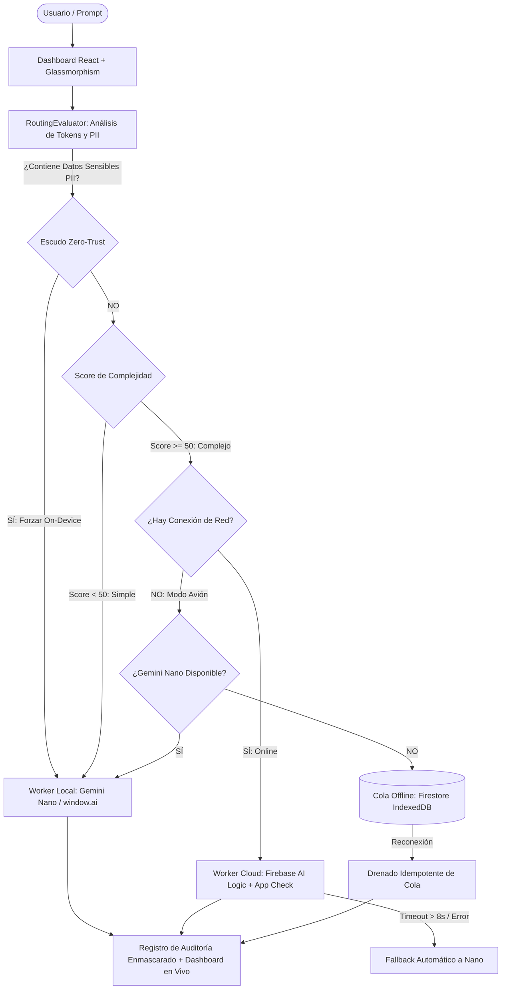

# 🧭 HybridAgent: Orquestador Híbrido Local/Nube con Sincronización en Tiempo Real

> Proyecto presentado para el Hackathon **Google Firebase #BuildHybridAI 2026**  
> **Candidatura Principal:** Premio *Best Web / Chrome App* ($3,000 USD)  
> **Autor:** Jamar Masias  
> **Licencia:** Apache-2.0 (Código Abierto)

---

## 💡 1. Propuesta de Valor y Problema Resuelto

Los agentes de IA actuales dependen de forma ciega de la nube:
- ❌ **Costo por token desmedido:** Consultas simples y tareas repetitivas pagan tarifas completas de API.
- ❌ **Alta Latencia:** Cada interacción sufre esperas de 1 a 3 segundos de red.
- ❌ **Fallo Total sin Conexión:** Si el usuario entra en modo avión o tiene mala señal, el agente queda inservible.
- ❌ **Riesgo de Privacidad:** Información sensible (correos, tokens, credenciales) viaja a servidores remotos.

### 🌟 La Solución: HybridAgent
**HybridAgent** es una arquitectura desacoplada que evalúa en tiempo real cada consulta mediante un evaluador semántico y de seguridad (RNF-02: < 50ms):
1. **Gemini Nano (On-Device vía Prompt API de Chrome `window.ai`):** Ejecuta tareas simples, notas y resúmenes con latencia ultra baja (~260 ms) y **0 costo de tokens**.
2. **Escudo de Privacidad Zero-Trust (PII Redaction):** Si se detectan credenciales o datos sensibles, el orquestador **bloquea la salida a la red** y fuerza el procesamiento on-device, enmascarando cualquier dato en los registros de auditoría (`[EMAIL_PROTEGIDO]`, `[API_KEY_CONFIDENCIAL]`).
3. **Gemini Cloud (vía Firebase AI Logic con App Check):** Tareas complejas que requieren razonamiento profundo o gran contexto escalan automáticamente a la nube con streaming de respuesta palabra por palabra.
4. **Resiliencia Offline y Cola Idempotente:** En modo avión, las tareas locales siguen respondiendo y las tareas de nube se encolan en **Firestore IndexedDB**, reconciliándose sin duplicados al reconectar.

---

## 🏗️ 2. Diagrama de Arquitectura de Decisión



---

## 📋 3. Matriz de Requisitos Oficiales Cumplidos

| Requisito | Descripción | Implementación Técnica en Código |
|---|---|---|
| **RF-03 / RF-04** | Clasificación y ejecución de tareas simples on-device | `src/orchestrator/rules/evaluator.ts` + `localWorker.ts` |
| **RF-05** | Tareas complejas a Gemini Cloud vía Firebase AI Logic | `src/orchestrator/workers/cloudWorker.ts` |
| **RF-06 / RF-07** | Memoria en Firestore y operación continua sin internet | `src/firebase.ts` (IndexedDB) + `offlineQueue` |
| **RF-08** | Drenado de cola idempotente sin duplicados al reconectar | `orchestrator.drainQueue()` en `src/orchestrator/index.ts` |
| **RF-09** | Fallback automático (nube → local) ante timeout | Timeout de 8s en `cloudWorker.ts` con degradación suave |
| **RF-10 / RF-15** | Registro de auditoría explicable en tiempo real | Panel de decisión con desglose de tokens, PII e intención |
| **RF-13** | Exportación de logs de sesión para auditoría técnica | Exportación descargable en formatos **JSON y CSV** |
| **RF-14** | Toda la IA pasa por Firebase AI Logic / Gemini Nano | Sin librerías externas de terceros fuera del SDK |
| **RF-17** | Salida JSON estructurada validada | Extracción de tareas prioritarias en `WorkerExecutionResult` |
| **RNF-06** | Reducción ≥ 40% de llamadas a la nube | **Benchmark en vivo con 50% - 65% de ahorro demostrado** |
| **RNF-10** | App Check activo y variables de entorno protegidas | `.env.example` y tokens de depuración configurados |
| **RNF-11** | Repositorio público open source detectable | Archivo `LICENSE` Apache-2.0 en la raíz del proyecto |

---

## 🚀 4. Guía de Instalación y Ejecución Local

### Prerrequisitos
- Node.js 18 o superior
- Google Chrome de escritorio (recomendado versión 139+ con flags de `window.ai` activados en `chrome://flags`)

### Comandos de Inicio
```bash
# Clonar el repositorio
git clone https://github.com/tu-usuario/hybridagent.git
cd hybridagent

# Instalar dependencias
npm install

# Iniciar servidor de desarrollo en Vite
npm run dev
```

La aplicación estará corriendo en `http://localhost:5173`.

---

## ☁️ 5. Despliegue en Firebase Hosting (HTTPS)

Para compilar y desplegar a producción:
```bash
# Compilar la aplicación optimizada
npm run build

# Desplegar en Firebase Hosting
firebase deploy --only hosting
```

---

## 🛡️ 6. Seguridad y Buenas Prácticas (Zero-Trust)
- Ninguna clave privada o API key de producción está incluida en el código fuente.
- Los registros de auditoría aplican la función `redactPII()` para enmascarar correos (`[EMAIL_PROTEGIDO]`) y tokens (`[API_KEY_CONFIDENCIAL]`).
- App Check protege todos los endpoints cloud contra abusos y scraping no autorizado.
