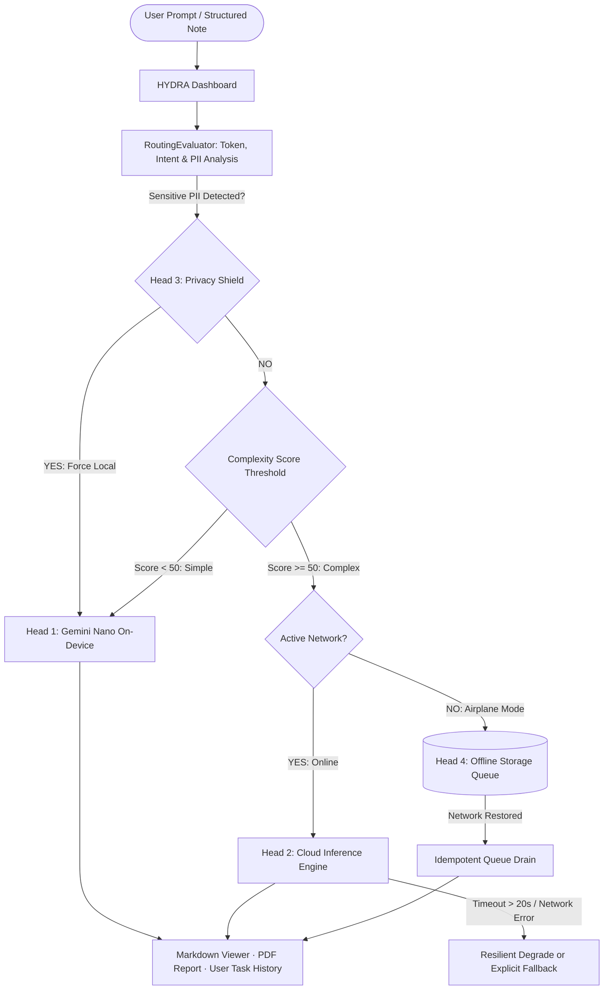

<div align="center">


# HYDRA Agent AI
### *Many heads. One decision: where to think.*

**Intelligent Hybrid Local & Cloud AI Orchestration Engine**

[](https://hydra-agent.vercel.app/)
[](LICENSE)
[](#4-automated-test-suite-2323-passing)
[](package.json)
[](package.json)

[Live Production App](https://hydra-agent.vercel.app/) · [Repository](https://github.com/jammar24/Hydra-Agent) · [License](LICENSE)

</div>

---

## 1. Overview & Problem Statement

Modern AI agents often rely exclusively on remote cloud APIs, creating four bottlenecks:
- **Unnecessary Token Costs:** Everyday queries and repetitive parsing incur full cloud billing.
- **Network Latency:** Simple requests experience 1–3 seconds of round-trip latency.
- **Complete Offline Failure:** When connectivity drops, the agent stops working entirely.
- **Privacy Risks:** Sensitive data (passwords, tokens, credentials, PII) leaves the user's device.

### The HYDRA Solution: 4 Specialized Heads
| Head | Engine | Responsibility |
| :--- | :--- | :--- |
| **Head 01 — Local Inference** | **Gemini Nano** (Chrome Desktop Prompt API) | On-device summaries, JSON extraction, and zero-cost execution (`< 2s` SLA). |
| **Head 02 — Cloud Inference** | **Gemini Cloud** (`gemini-3.5-flash-lite`) | Deep reasoning & large-context synthesis with `20s` timeout, token streaming, and explicit `[Fallback: ...]` error surfacing. |
| **Head 03 — Privacy Shield** | **Zero-Trust Evaluator** (`< 50ms`) | In-memory regex scanner for emails, API keys, passwords, cards, and IDs/SSNs — blocks cloud dispatch and forces local execution. |
| **Head 04 — Offline Sync** | **Firestore + IndexedDB** | Executes simple tasks offline and queues complex workloads for idempotent reconciliation upon reconnection. |

---

## 2. Architectural Decision Flow



---

## 3. Key Dashboard Capabilities

- **Consola & Historial Tabs:** Dedicated **Consola** for real-time dispatch + XAI decision vector (`< 50ms`) and **Historial** tab showing executed user tasks (`users/{uid}/tasks/{taskId}` in Cloud Firestore + `localStorage` backup) with `ID: task_...`, prompt, head used, latency, savings, route filters, and 1-click **Ver en Visor**.
- **Rich Markdown & Code Blocks:** Clean dark/light themed Markdown renderer with headings, lists, horizontal rules, and fenced code blocks with 1-click **Copy code**.
- **Automatic Main Task Summary:** If a conversational or code response returns no JSON subtasks, the **Tareas Estructuradas Extraídas** block renders an automatic summary card of the main task.
- **Technical PDF Export:** 1-click **Generar PDF** button next to **Copiar** in the response header, generating a clean light-mode technical report with task ID, timestamp, prompt, XAI metrics, and full response.
- **Responsive Multi-Device UI:** Adaptive layout across mobile (`<= 640px`), tablet (`<= 1024px`), desktop, and 32-inch QHD/4K monitors (`>= 1600px`).

---

## 4. Automated Test Suite (23/23 Passing)

```bash
npm test
```

- **PT-01 / PT-01b:** Simple on-device task routing and latency SLA verification.
- **PT-02 / PT-02b:** Complex task escalation to Gemini Cloud (`complexityScore >= 50`).
- **PT-03 / PT-04 / PT-04b:** Offline queue storage, reconnection, and idempotent drain.
- **PT-05:** Audit telemetry recording (reason, latency, tokens, cost savings).
- **PT-06 (a-d) & PT-07 (a-c):** Zero-Trust PII detection and in-memory redaction (`[EMAIL_PROTEGIDO]`, `[API_KEY_CONFIDENCIAL]`).
- **PT-08 (a-c):** Cascade speculative mode (Nano draft + Cloud synthesis).
- **PT-09 (a-c):** XAI multidimensional decision vector (`< 50ms` evaluation).
- **PT-10 (a-b):** Audit log export integrity in JSON and formula-safe CSV.

---

## 5. Local Quick Start

### Prerequisites
- Node.js 18+
- Modern Chromium browser (Chrome 139+ recommended for native Prompt API)

```bash
# 1. Clone the repository
git clone https://github.com/jammar24/Hydra-Agent.git
cd Hydra-Agent

# 2. Install dependencies
npm install

# 3. Configure environment variables
cp .env.example .env.local

# 4. Run automated tests
npm test

# 5. Start development server
npm run dev
```

Open `http://localhost:5173`.

---

## 6. Production Deployment & Environment Variables

Pre-configured for Vercel (`vercel.json`) and Firebase Hosting (`firebase.json`):

```bash
npm run build
npx vercel --prod
```

| Variable | Default / Example | Purpose |
| :--- | :--- | :--- |
| `VITE_FIREBASE_*` | Firebase project config | Auth, Firestore (`users/{uid}/tasks/{taskId}`), and App Check |
| `VITE_DEFAULT_CLOUD_MODEL` | `gemini-3.5-flash-lite` | Target Gemini Cloud model |
| `VITE_LOCAL_MODEL_MAX_TOKENS` | `9216` | Token ceiling before cloud escalation |
| `VITE_CLOUD_TIMEOUT_MS` | `20000` | Cloud `AbortController` & worker timeout (20s) |
| `VITE_GEMINI_API_KEY` | `<your-key>` | Live Gemini Cloud REST API key (never commit real keys) |

---

## 7. Security & Data Protection

- **Secret Hygiene:** Production keys live strictly in gitignored `.env.local` or Vercel Environment Variables.
- **In-Memory PII Shield:** Redacts emails, API keys, passwords, credit cards, and IDs/SSNs before logging or network dispatch.
- **Authentication & App Check:** Google Sign-In (`signInWithPopup` with automatic `signInWithRedirect` + `getRedirectResult` fallback) and Email/Password via Firebase Auth, backed by App Check attestation.
- **HTTP Hardening (`vercel.json`):** `Content-Security-Policy`, `Strict-Transport-Security`, `X-Frame-Options: DENY`, `X-Content-Type-Options: nosniff`, `Referrer-Policy`, `Permissions-Policy`, `Cross-Origin-Opener-Policy: same-origin-allow-popups`, and `Cross-Origin-Embedder-Policy: credentialless`.
- **Export Sanitization:** Neutralizes CSV formula injection (`=`, `+`, `-`, `@`) and escapes HTML in PDF print reports.

---

## 8. License

Distributed under the **Apache-2.0** Open Source License. See [`LICENSE`](LICENSE) for details.  
Copyright (c) 2026 **Jamar Masias** — HYDRA Agent AI.
